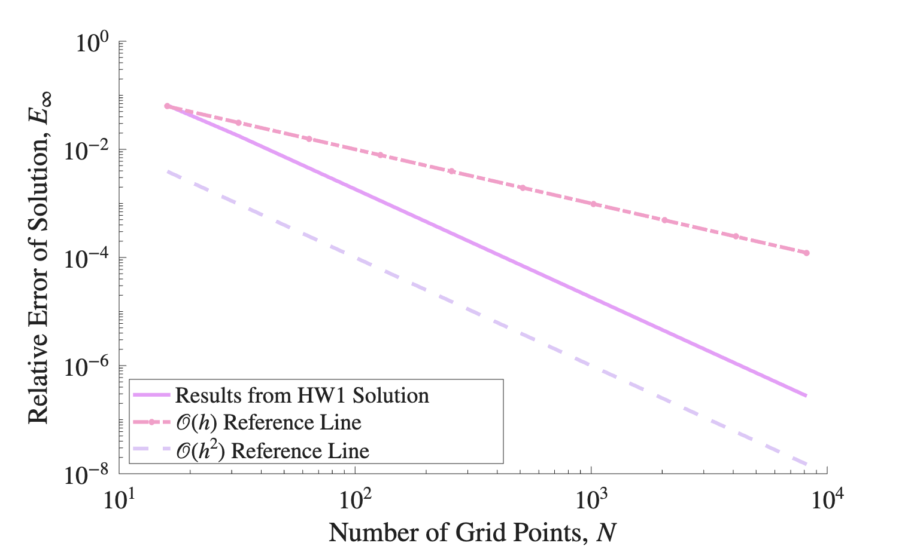

# 1D Finite Difference Convergence

Computes the derivative of f(x) = exp(sin(2πx/L)) on the periodic domain [0, L) with L = 2π, using the second-order central difference
and compares it to the exact derivative. Periodic boundary conditions are implemented.

The relative max-norm error E∞ is computed for N = 16, 32, ..., 8192 and written to `HW1_Error_Data.csv`. The error converges with second-order accuracy, as seen below.



## Running

```bash
make HW1        # builds and runs N = 16 ... 8192
make clean      # removes the executable
```

Then run `plot_error.m` in MATLAB to make the error plot. It saves `HW1_Error_Plot.png` to the current folder.
