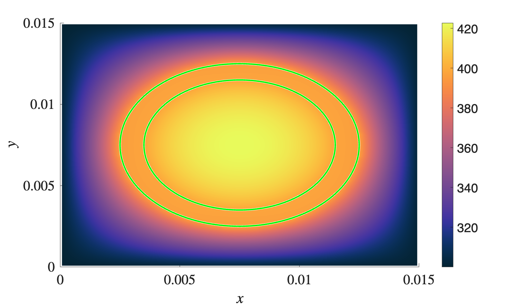
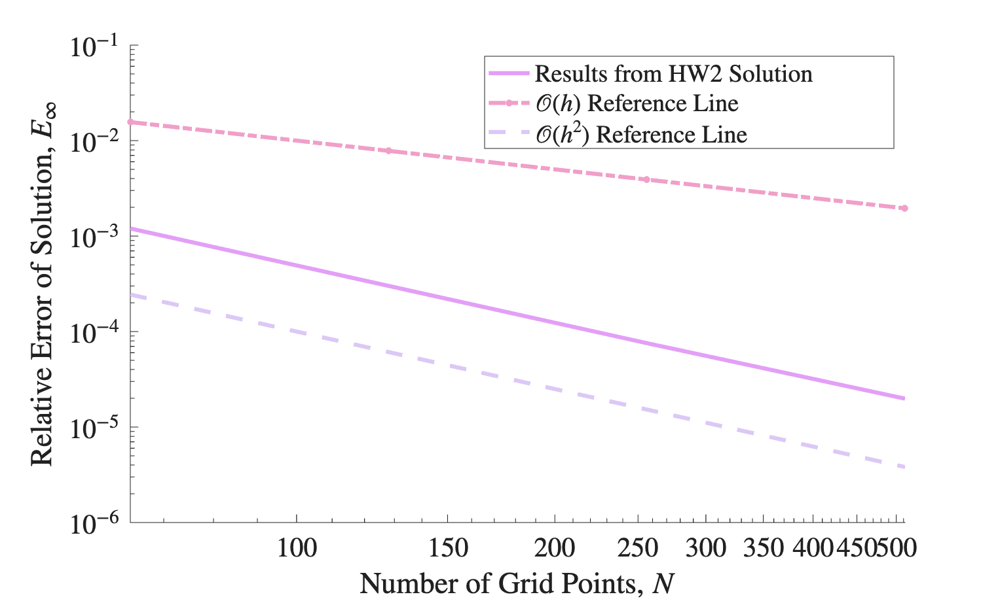

# 2D Steady Heat Conduction with Variable Conductivity

Solves the steady diffusion equation

    ∇·(k(x,y) ∇T) = -f(x,y)

with a cell-centered finite volume method on a uniform 2D mesh, with Dirichlet boundary conditions throughout. Conductivity is evaluated at cell faces, so the scheme handles conductivity that jumps between materials.
The sparse system is solved with Eigen's `SparseLU`.

## Cases

| Folder | Description |
|---|---|
| `No_k` | Constant conductivity, checked against the manufactured solution c = cos(x) cos(y) with f = 2 cos(x) cos(y) |
| `With_K_m` | Smoothly varying conductivity k = 1 + 0.5 sin(x) sin(y), checked against the same manufactured solution |
| `Fuel_Rod` | Cross-section of a nuclear fuel rod: fuel (r < R1), cladding (R1 < r < R2) and coolant regions with different conductivities, a heat source s = a(1 + b(r/R1)²) in the fuel and a fixed coolant temperature Tc on the outer boundary |

Both verification cases converge at second order under mesh refinement. The solution plots for the verification cases use Lx = Ly = 2π and Nx = Ny = 128 (`inputs_base`).

The fuel rod case uses Nx = Ny = 100, Lx = Ly = 0.015 m, R1 = 0.004 m, R2 = 0.005 m, k1 = 2.0, k2 = 15.0 and k3 = 0.6 W/m/K, a = 1.0e7, b = 1.0 and Tc = 300 K (`inputs`).

<p align="center">
  
  
</p>

## Running

```bash
make runAll       # fuel rod case and both verification cases
make ErrorPlots   # mesh refinement study, N = 64 ... 512 (edits inputs_error)
make clean        # removes the executables
make clean_data   # removes the output data files
```

Each case can also be run on its own with `make FuelRod`, `make NoK` or `make WithKm`.

Then run the MATLAB scripts to make the plots:

| Script | Plot |
|---|---|
| `No_k/err_no_k.m` | Error plot, constant conductivity |
| `No_k/vis_no_k.m` | Numerical and analytical solution, constant conductivity |
| `With_K_m/err_w_k.m` | Error plot, variable conductivity |
| `With_K_m/vis_k_m.m` | Numerical and analytical solution, variable conductivity |
| `Fuel_Rod/fuel_rod_plot.m` | Fuel rod temperature field |

Shared functions (input reader, conductivity and source models) are in `funcs_HW2.cpp`.
