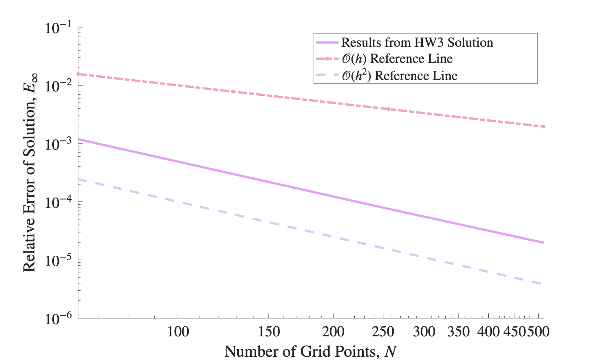
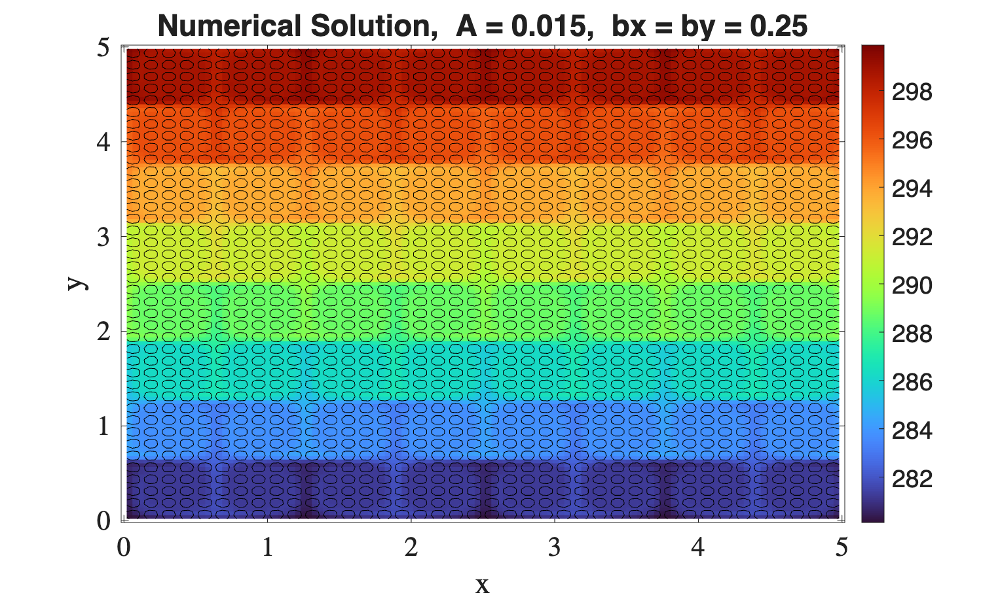

# 2D Steady Advection-Diffusion

Steady temperature transport in a prescribed velocity field:

    ρ c_p (u·∇T) = ∇·(k ∇T) + f

The velocity is a cellular (divergence-free) flow, which we use to model air moved by a ceiling fan:

    u = -A/(by Ly) sin(2πx/(bx Lx)) cos(2πy/(by Ly))
    v =  A/(bx Lx) cos(2πx/(bx Lx)) sin(2πy/(by Ly))

where A sets the flow amplitude and bx, by set the size of the cells. A = 0 gives pure diffusion.

The solver was built in stages, with a verification case at each step before moving on. All verification cases use the manufactured solution T = cos(x) cos(y):

| Folder | Purpose |
|---|---|
| `1_diffusion_dirichlet_verification` | Pure diffusion with Dirichlet BCs on all walls |
| `2_diffusion_neumann_verification` | Pure diffusion with Dirichlet BCs on the north/south walls and Neumann BCs on the east/west walls |
| `3_advection_diffusion_verification` | Full advection-diffusion with the same boundary conditions as `2_diffusion_neumann_verification` |
| `4_parameter_sweeps` | Ceiling fan application: air properties (ρ = 1.225 kg/m³, c_p = 1005 J/kg·K, k = 0.026 W/m·K) with sweeps over A and bx = by |

All three verification cases show second-order convergence on meshes from 64² to 512². The solution plots for the verification cases use Lx = Ly = 2π and Nx = Ny = 128.

<p align="center">
  
  
</p>

## Ceiling fan application

The room is 5 m × 5 m on a 128 × 128 mesh, with T = 280 K on the floor (y = 0), T = 300 K on the ceiling (y = Ly), and Neumann conditions on the side walls. There is no source term.

## Code layout

| File | Contents |
|---|---|
| `funcs_Case.cpp` | Reads fluid properties and BCs from `Case.inp` |
| `funcs_Mesh.cpp` | Builds face and cell-center coordinates from `Mesh.inp` |
| `funcs_Adv.cpp` | Velocity field and face fluxes |
| `funcs_Build.cpp` | Assembles the sparse matrix and right-hand side |
| `funcs_EigenSolve.cpp` | Sparse LU solve and output |

## Running

```bash
cd <case_of_interest>
make build
make run
make ErrorData    # verification folders only: mesh refinement study, N = 64 ... 512
make clean        # removes the executable and output data files
```

Run `viz.m` in each folder to make the solution plots and `errorplot.m` to make the error plots.

In `4_parameter_sweeps`, `A_Sweep.sh` varies A from 0 to 1e-2 with bx = by = 2 and `B_Sweep.sh` varies bx = by from 1 to 0.25 with A = 0.015.
