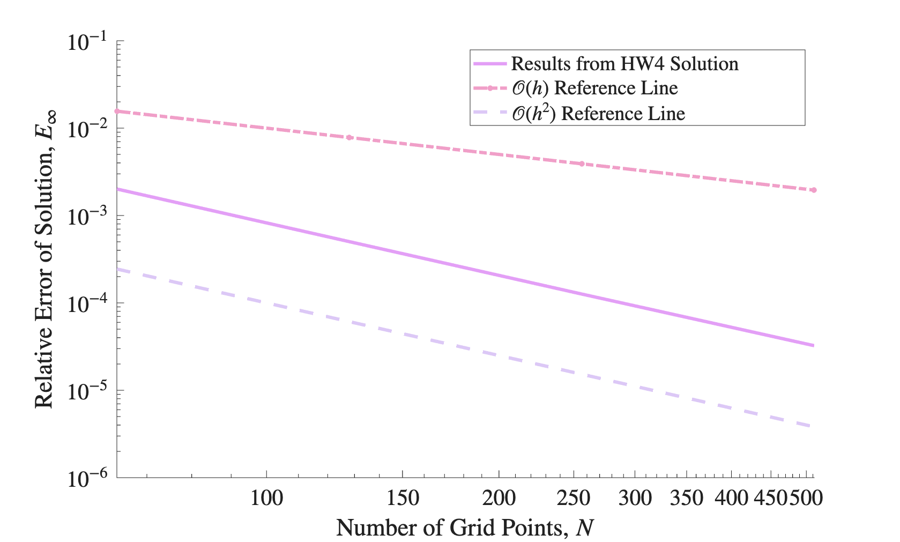
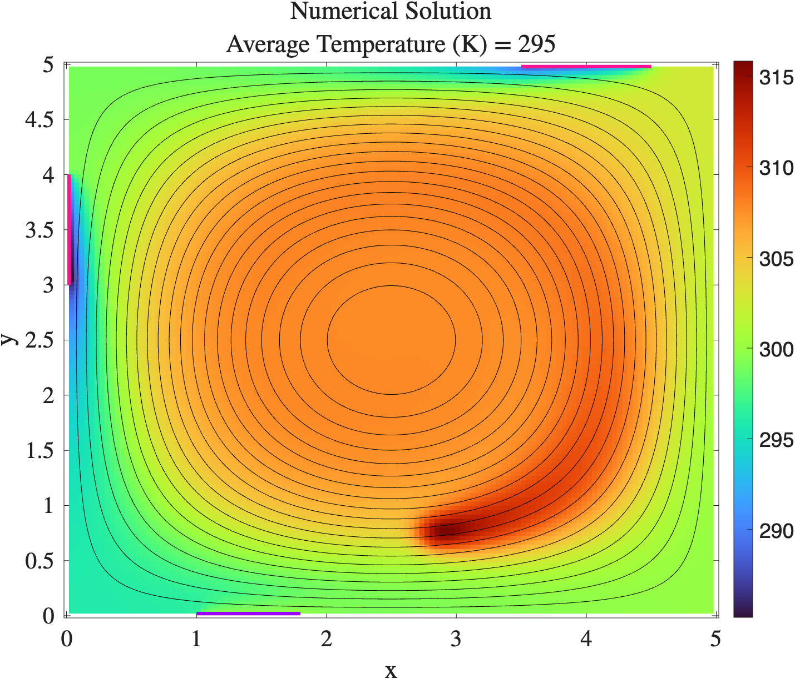

# Room Heating with Robin Boundary Conditions

Extends the advection-diffusion solver to a general boundary condition

    a T + b ∂T/∂n = g

which covers Dirichlet (b = 0), Neumann (a = 0) and Robin conditions with one implementation. Boundary conditions are set by position along each wall, so a single wall can have a window, a door and an insulated section.

The model problem is a 5 m × 5 m room with a ceiling fan and

- **Windows** on the north and west walls lose heat to the outside by convection (Robin: -k ∂T/∂n = h (T - T_ext))
- **Door** on the south wall held at a fixed temperature (Dirichlet)
- **Walls** insulated (Neumann)
- **Air flow** circulating clockwise (A = 0.01), counterclockwise (A = -0.01), or not at all (A = 0)

| Folder | Purpose |
|---|---|
| `1_verification` | Robin BCs checked against the manufactured solution T = cos(x) cos(y), second-order convergence |
| `2_room` | Room with windows and a door, no heat source |
| `3_room_with_heater` | Adds a space heater, modeled as a Gaussian heat source |

<p align="center">
  
  
</p>

## Inputs

| Parameter | Value | Description |
|---|---|---|
| ρ, c_p, k | 1.225 kg/m³, 1005 J/(kg·K), 0.026 W/(m·K) | Air properties |
| A | 0.01 | Velocity amplitude (sign sets the flow direction) |
| bx, by | 2, 2 | Flow parameters |
| Nx, Ny | 128, 128 | Mesh |
| Lx, Ly | 5 m, 5 m | Room size |
| h | 0.1 W/(m²·K) | Window heat transfer coefficient |
| T_ext | 260 K | External temperature |
| Td | 300 K | Door temperature |
| Ts | 75 | Heater source amplitude |
| h1, h2 | 4.58 m, 2.71 m | Heater center (x, y) |
| n1, n2 | 3.5 m, 4.5 m | North window |
| w1, w2 | 3 m, 4 m | West window |
| s1, s2 | 1 m, 1.8 m | South door |

The results above use these values, except for A and the heater location. Mesh and room size are set in `Mesh.inp`, air properties and flow in `Case.inp`, and boundary and heater values in `BC.inp`.

## Running

```bash
cd <case_of_interest>
make build
make run
make ErrorData    # 1_verification only: mesh refinement study, N = 64 ... 512
make clean        # removes the executable and output data files
```

Run `viz.m` in each folder to make the solution plots and `errorplot.m` in `1_verification` to make the error plot.
