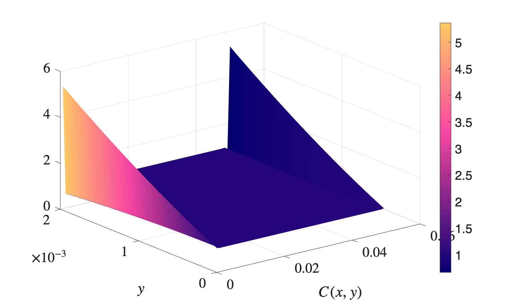
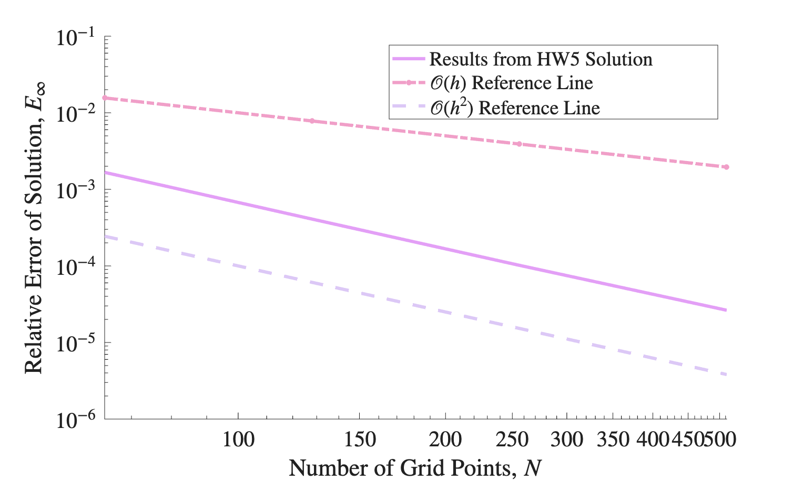

# Mass Transfer in a Channel with Permeable Walls

Steady solute transport in a 2D channel whose walls are membranes. Fluid enters at the west end and leaks out through the top and bottom walls, while the solute is held back. Solute builds up next to the membrane (concentration polarization), which makes filtration harder.

The solute concentration c satisfies the steady advection-diffusion equation

    u ∂c/∂x + v ∂c/∂y = D (∂²c/∂x² + ∂²c/∂y²)

where D is the mass diffusivity (`k` in `C.inp`). The velocity field is the analytical solution for laminar flow in a channel with uniform wall suction V_m:

    u = 1.5 U_in (1 - (V_m/U_in) x/h) (1 - ŷ²)
    v = (V_m/2) (3ŷ - ŷ³),          ŷ = (y - h)/h,   h = Ly/2

Boundary conditions:

- **Inlet (west):** fixed concentration C_in = 1 (Dirichlet)
- **Membrane walls (north/south):** zero net solute flux, -D ∂c/∂y + v c = 0 (Robin)
- **Outlet (east):** zero-gradient (Neumann) or linear extrapolation from the two nearest interior cells

The channel is 5 cm long and 2 mm tall (Lx = 0.05 m, Ly = 0.002 m), with U_in = 0.1 m/s and V_m = 1e-5 m/s. The diffusivity goes as low as 1e-12 m²/s, so transport is strongly advection-dominated and the concentration boundary layer at the wall is very thin.

| Folder | Purpose |
|---|---|
| `1_verification` | Manufactured-solution check (c = sin(x) sin(y)) of the advection-diffusion operator with Robin wall conditions, second-order convergence |
| `2_extrapolation_outlet` | Main case: outlet concentration linearly extrapolated from the interior, with mesh refinement (64² to 512²) and a diffusivity sweep (1e-9 to 1e-12) |
| `3_neumann_outlet` | The same case with a zero-gradient outlet, which produces oscillations along the edges that do not go away with mesh refinement |

<p align="center">
  
  
</p>

## Code layout

This version restructures the solver into classes for the mesh (`meshType`), cell-centered fields (`volScalarField`), face fluxes (`surfaceScalarField`), the velocity field (`velocityField`), boundary conditions (`bcType`) and the linear system (`matrixType`).

## Running

```bash
cd <case_of_interest>
make build
make run

#make ErrorData    # case 1 only - verify method
#make DiffData     # case 2 only - sweep over diffusivity
```

`make clean` removes the executable and output data files. Run `viz.m` in each folder to make the solution plots, `errorplot.m` in `1_verification` for the error plot, and `diffplot.m` in `2_extrapolation_outlet` to plot the diffusivity sweep.
