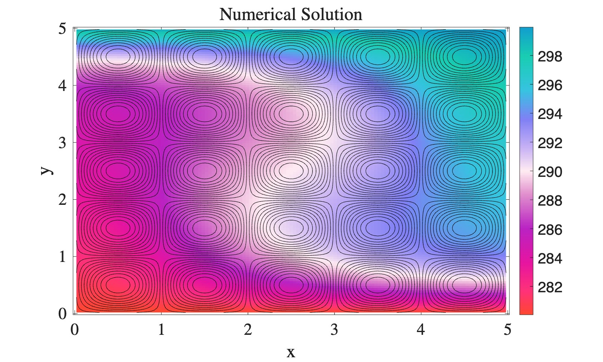
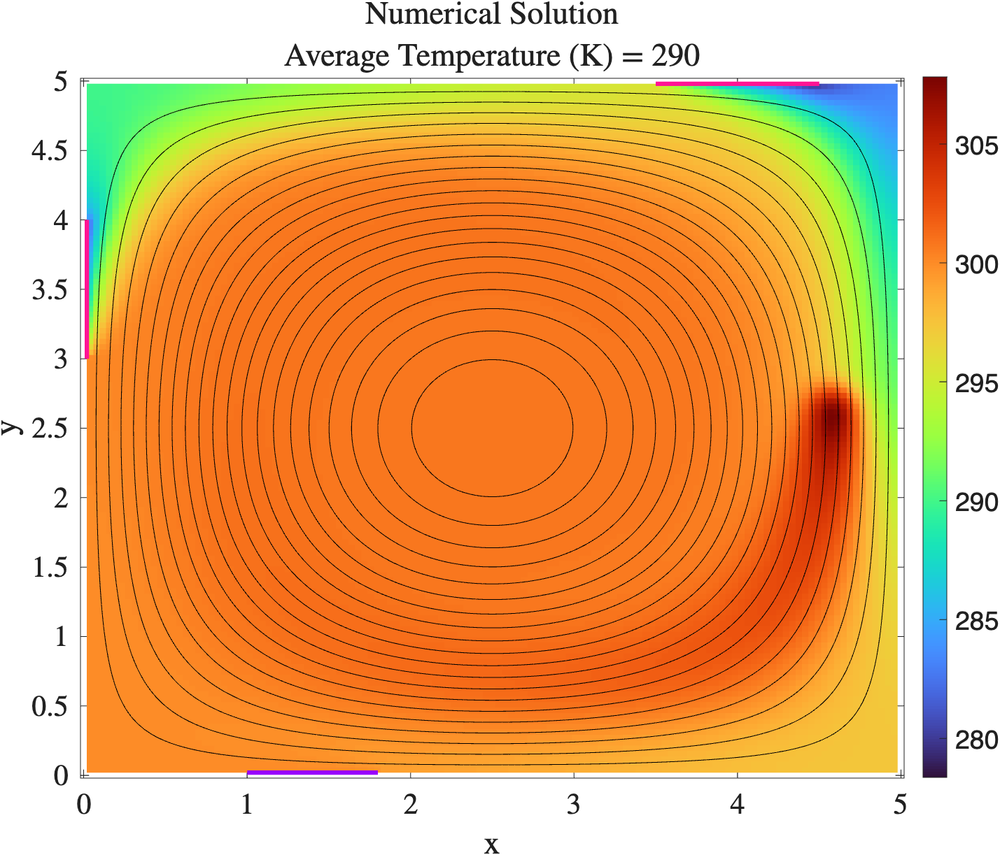

# Advanced Computational Fluid Dynamics

Finite volume solvers I wrote in C++ for the Advanced Computational Fluid Dynamics course at Colorado School of Mines (Spring 2026). The projects build on each other, starting with a 1D finite difference convergence study and ending with a transient 2D advection-diffusion solver.

Every solver is checked against a manufactured or analytical solution and mesh refinement studies confirm the expected order of accuracy before the code is used on a physical problem.

<p align="center">
  
  
</p>

*Left: steady temperature field advected by a cellular flow. Right: room heating with windows, a door, a heater and a circulating flow.*

## What's in here

- **Finite volume discretization** of steady and transient advection-diffusion on 2D structured, cell-centered meshes
- **Boundary conditions:** Dirichlet, Neumann, Robin (convective heat loss through windows) and extrapolation outflow
- **Verification:** method of manufactured solutions with grid convergence studies showing second-order spatial accuracy, plus a separate temporal convergence study
- **Linear algebra:** sparse matrix assembly and direct solves with [Eigen](https://eigen.tuxfamily.org) (`SparseLU`)
- **Code structure:** mesh, field, flux, boundary condition and matrix classes, each in its own header/source pair, with inputs read from plain-text files
- **Automation:** Bash scripts for mesh refinement studies and parameter sweeps
- **Post-processing:** MATLAB and Python (pandas, Matplotlib) for contour plots and convergence plots

## Projects

| Folder | Problem | Highlights |
|---|---|---|
| [`01_finite_difference_convergence`](01_finite_difference_convergence) | Derivative of a periodic function | Second-order central differences, error vs. N |
| [`02_variable_conductivity_heat_conduction`](02_variable_conductivity_heat_conduction) | 2D steady heat conduction | Spatially varying conductivity, nuclear fuel rod model with fuel, cladding and coolant regions |
| [`03_steady_advection_diffusion`](03_steady_advection_diffusion) | 2D steady advection-diffusion | Built up step by step with a verification case at each stage, then parameter sweeps over flow strength and length scale |
| [`04_robin_bc_room_heating`](04_robin_bc_room_heating) | Heating a room with windows and a door | Robin boundary conditions, effect of flow direction and a localized heat source |
| [`05_membrane_channel_mass_transfer`](05_membrane_channel_mass_transfer) | Solute transport in a channel with permeable walls | Advection-dominated flow (diffusivity down to 1e-12), comparison of outflow boundary conditions |
| [`06_transient_advection_diffusion`](06_transient_advection_diffusion) | 2D transient advection-diffusion | Implicit time stepping, factor once and reuse the matrix, spatial and temporal convergence studies |

Each folder has its own README with the governing equations, how to run it and the results.

## Building

The solvers need a C++ compiler and the Eigen headers.

```bash
# macOS
brew install eigen
```

Each folder has its own Makefile. The Makefiles point to where Eigen lives on my machine (`-I/Users/rachelbertaud/code/eigen-5.0.0`), so change that path to your Eigen install before building:

Inputs are plain-text files (`Mesh.inp`, `Case.inp`, etc.) with each parameter name on one line and its value on the next.

The MATLAB plotting scripts load a personal plot style (`plot_settings`) and colormap package; remove those lines to run them with MATLAB defaults.
